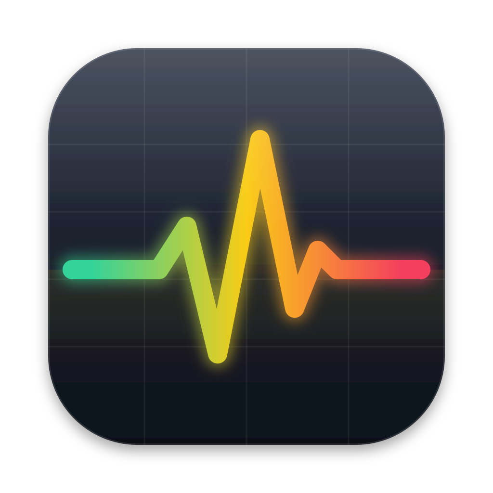
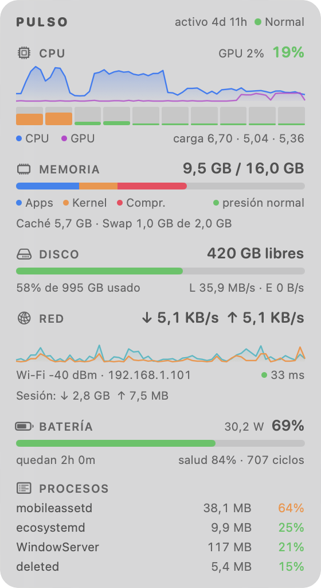

<p align="center">
  
</p>

<h1 align="center">Pulso</h1>

<p align="center">
  Widget flotante y semitransparente para macOS que muestra el rendimiento del Mac en vivo.<br>
  <sub>A floating, translucent live performance widget for macOS (Apple Silicon). UI in Spanish.</sub>
</p>

<p align="center">
  
</p>

## Qué muestra

- **CPU**: uso total, gráfico histórico junto al de la **GPU**, barras por núcleo y carga media.
- **Memoria**: desglose apps / kernel / comprimida, presión de memoria, caché y swap.
- **Disco**: espacio libre y velocidad de lectura/escritura.
- **Red**: subida y bajada en vivo, señal Wi-Fi, IP local, latencia a internet y totales de la sesión.
- **Batería**: porcentaje, consumo en vatios, tiempo restante, salud y ciclos.
- **Procesos**: los que más CPU consumen en este momento.
- **Estado térmico** y tiempo encendido.

Además envía **avisos** (notificaciones) cuando la memoria está al límite, queda poco disco,
la batería está baja, se pierde internet o el equipo se calienta.

Es una app nativa (SwiftUI + AppKit), ligera: ~2–3 % de CPU visible y prácticamente nada
cuando está oculta o tapada, porque deja de medir.

## Requisitos

- Mac con **Apple Silicon** (M1 o posterior). No funciona en Macs con procesador Intel.
- **macOS 14 Sonoma** o superior.

## Instalación

### Opción A: descargar la app

1. Descarga `Pulso-x.y.zip` desde la página de [Releases](../../releases/latest).
2. Descomprímelo y mueve `Pulso.app` a la carpeta **Aplicaciones**.
3. Ábrela. La primera vez macOS la bloqueará; sigue los pasos de abajo.

#### Primera apertura

Pulso es gratuita y no está firmada con un certificado de desarrollador de Apple
(cuesta USD 99 al año), así que macOS muestra un aviso del tipo
*“Apple no pudo verificar que «Pulso» esté libre de malware”*. Para abrirla:

1. Intenta abrir Pulso y cierra el aviso (botón **Listo**).
2. Ve a **Ajustes del Sistema → Privacidad y seguridad**.
3. Abajo aparecerá *“Se bloqueó el uso de «Pulso»”*: pulsa **Abrir igualmente** y confirma con tu contraseña.

Solo hay que hacerlo una vez. Si prefieres la terminal, esto equivale a:

```sh
xattr -dr com.apple.quarantine /Applications/Pulso.app
```

Si no te fías de un binario descargado, usa la opción B: el código es corto y puedes revisarlo.

### Opción B: compilar desde el código

Solo necesitas las herramientas de línea de comandos de Xcode (no hace falta Xcode completo):

```sh
xcode-select --install          # si no las tienes
git clone https://github.com/vicvinue/Pulso.git
cd Pulso
./build.sh install              # compila e instala en ~/Applications/Pulso.app
```

Una app compilada en tu propio Mac no pasa por la verificación de Gatekeeper.

## Uso

Pulso no aparece en el Dock; vive como widget y como icono en la barra de menús.

| Acción | Cómo |
|---|---|
| Mostrar / ocultar el widget | <kbd>⌃</kbd><kbd>⌥</kbd><kbd>P</kbd> o el icono de la barra de menús |
| Ignorar clics (los clics atraviesan el widget) | <kbd>⌃</kbd><kbd>⌥</kbd><kbd>C</kbd> |
| Mover | Arrastrar el widget |
| Modo compacto | Doble clic sobre el widget |
| Ajustes | Clic derecho sobre el widget o clic en el icono de la barra de menús |

En el menú puedes cambiar la **opacidad**, la **posición** (siempre encima o en el escritorio,
detrás de las ventanas), el **tema** (oscuro, claro o según el sistema), el servidor y la
frecuencia de la **latencia**, qué **avisos** recibir y si Pulso se **abre al iniciar sesión**.

### Avisos

La primera vez Pulso pide permiso para enviar notificaciones. Si no te llegan, revisa
**Ajustes del Sistema → Notificaciones → Pulso** y que no esté activo *No molestar*.
Desde el menú **Avisos → Enviar aviso de prueba** puedes comprobarlo.

### Privacidad

Pulso no recopila ni envía datos. La única conexión de red que hace es medir la latencia
(abre una conexión TCP al puerto 443 de 1.1.1.1 por defecto y la cierra; el servidor se elige o se desactiva desde el menú).

## Desarrollo

```
Sources/        código Swift (main, WidgetView, Monitor, Samplers, Alerts, HotKeys)
Resources/      icono: AppIcon.svg (fuente) → AppIcon.icns
build.sh        compila con swiftc; `./build.sh install` instala y abre la app
release.sh      empaqueta dist/Pulso-<versión>.zip; `--publish` crea la release en GitHub
```

Para cambiar el icono edita `Resources/AppIcon.svg`; `build.sh` regenera el `.icns` si tienes
`rsvg-convert` (`brew install librsvg`).

Los ajustes se guardan en `defaults read cl.vicvinue.pulso`.

## Licencia

[MIT](LICENSE)
